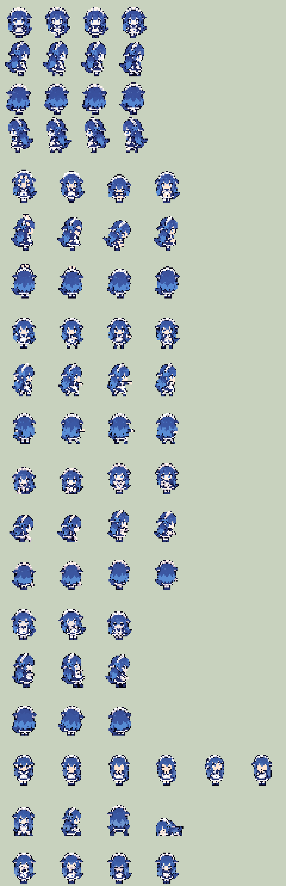

# Whale Farmer 🐳

把《星露谷物语》的玩家角色换成「蓝色大肥鱼」：一个穿女仆装、长着鲸鱼鳍耳朵和鲸鱼尾巴的像素小人（DeepSeek 鲸鱼娘的粉丝形象）。

A SMAPI mod that replaces the Stardew Valley farmer with a chibi whale-girl maid sprite (fan art of the DeepSeek whale mascot).



> 这是粉丝作品，与 DeepSeek 官方、ConcernedApe 均无关。角色像素图由 AI 生成后经脚本转换。

## 功能

- 走路：4 个方向，各 4 帧动画
- 按动作切换姿态：挥锄头/斧头/镐子、挥剑和镰刀、蹲下收菜、浇水、挤奶、钓鱼（等待和收线）、吃喝、举起物品、骑马/坐下、晕倒、吃惊/大笑/恶心/害羞
- 游戏菜单、地图、锻造台等处的小头像也会换成鲸鱼娘
- 按 **F9** 随时切回原版外观（可在 `config.json` 里改键）
- 缺少某张姿态图时自动用站立姿势代替，不会崩

## 安装

1. 安装 [SMAPI](https://smapi.io/)（4.0 以上），游戏版本 1.6.14 以上。
2. 把 `WhaleFarmer` 文件夹（含 `WhaleFarmer.dll`、`manifest.json`、`assets`）放进游戏的 `Mods` 目录。
3. 用 SMAPI 启动游戏。

从源码编译：需要 .NET 6 以上 SDK，编辑 `build.ps1` 里的工具链路径后运行它，会编译并直接装进 `Mods\WhaleFarmer`（游戏开着时 dll 被占用，先退出游戏）。

## 配置（config.json）

| 字段 | 默认 | 说明 |
|---|---|---|
| `Enabled` | `true` | 是否启用鲸鱼娘外观 |
| `ToggleKey` | `F9` | 切换外观的快捷键 |
| `WalkFrameMs` | `180` | 走路每帧毫秒数，跑步自动加快 |
| `OnlyLocalPlayer` | `true` | 只替换自己；关掉后联机的其他玩家也显示成鲸鱼娘（只在你的画面上） |

## 已知限制

- **整套替换**：帽子、衣服、发型、配饰都不显示；和 Fashion Sense 等同样接管农夫绘制的模组一起用可能冲突（启动时日志会提示）。
- 工具、武器、鱼竿由游戏按原版农夫的手臂位置绘制，和鲸鱼娘的手可能对不太齐。
- 泳衣、少数剧情专用动作没有专门的姿态，会显示站立或最接近的姿态。
- 多人联机时，其他玩家要自己装这个模组才能看到你的鲸鱼娘。

## 工作原理

用 Harmony 拦截 `FarmerRenderer.draw`（所有农夫绘制最终都会调用的那个重载）和 `drawMiniPortrat`。
原版每个动作都有固定的帧编号（参考 [Wiki: Modding:Farmer sprite](https://stardewvalleywiki.com/Modding:Farmer_sprite)），`Poses.cs` 根据帧编号和手上拿的工具，把一百多个原版帧归到 7 张姿态图里：

| 文件 | 网格 | 内容 |
|---|---|---|
| `walk.png` | 4×4 | 走路：朝下、朝右、朝上、朝左 |
| `tools.png` | 4×3 | 挥重工具（锄头、斧头、镐子、抛竿） |
| `melee.png` | 4×3 | 挥武器（剑、镰刀、匕首、弹弓） |
| `crouch.png` | 4×3 | 蹲下伸手、抓取、举水壶、倒水 |
| `fishing.png` | 3×3 | 等鱼咬钩、收线两帧 |
| `eat.png` | 6×1 | 举起物品、吃、喝（只有朝下） |
| `misc.png` | 4×2 | 坐下三方向、躺下；吃惊、大笑、恶心、害羞 |

三行的表按「朝下、朝右、朝上」排列，朝左时把朝右那行镜像。每格的角色脚底对齐格子底部、水平居中，画的时候对齐到原版 16×32 身体的同一位置。

## 自己重画 / 换角色

`art/` 里是完整的素材流程：

1. `art/prompts.md`：给图像模型的提示词（品红背景、固定网格、每次附上走路图当参考）。
2. `art/source/`：模型生成的原图（1024×1536）。
3. `art/pixelize.py`：把原图转成真正的低分辨率像素帧——抠品红背景、按块取主色、压缩调色板、脚底和头部对齐；`--strip-tool` 能尽量抠掉图里的工具（游戏会自己画），但效果不如直接让模型画空手姿势，`--ref r,c --height 26` 按某一格的站立高度统一大小；`--front` 标出正脸的格子，取样时会多试几种起点，挑左右眼最对称的（同一行共用一个起点，动画不抖）。

```bash
python art/pixelize.py art/source/1-full.png WhaleFarmer/assets/walk.png --cols 4 --rows 4 --block 10.33 --front 0
python art/pixelize.py art/source/4-tools.png WhaleFarmer/assets/tools.png --cols 4 --rows 3 --ref 0,3 --height 26 --cell 40x40 --front 0
python art/pixelize.py art/source/5-melee.png WhaleFarmer/assets/melee.png --cols 4 --rows 3 --ref 0,0 --height 26 --cell 40x40 --front 0
python art/pixelize.py art/source/6-crouch.png WhaleFarmer/assets/crouch.png --cols 4 --rows 3 --ref 0,2 --height 26 --cell 40x40 --front 0
python art/pixelize.py art/source/7-fishing.png WhaleFarmer/assets/fishing.png --cols 3 --rows 3 --ref 0,0 --height 26 --cell 40x40 --front 0
python art/pixelize.py art/source/8-eat.png WhaleFarmer/assets/eat.png --cols 6 --rows 1 --ref 0,1 --height 26 --cell 40x40 --front 0
python art/pixelize.py art/source/9-misc.png WhaleFarmer/assets/misc.png --cols 4 --rows 2 --ref 1,3 --height 26 --cell 40x40 --front 1,0:0
```

需要 Python 3、numpy、Pillow。

## 许可

代码使用 MIT 许可（见 `LICENSE`）。角色形象是粉丝创作，像素素材仅供个人、非商业使用。
